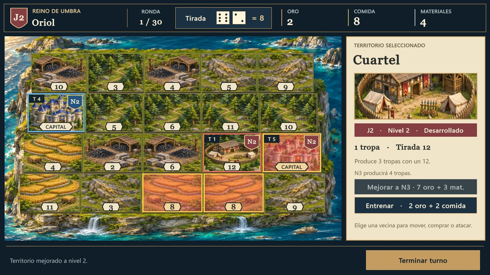

# Atlas de Aethria

Juego de estrategia por turnos para dos personas en Windows. Cada jugador dirige un reino en una isla de 20 territorios. Los dados activan la producción de los edificios y cada jugador decide cuándo gastar sus recursos, mover tropas y terminar su turno. Ganas al conquistar la capital rival o por puntuación tras 30 rondas.

**[Última versión publicada para Windows](https://github.com/JordiESMA/atlas-de-aethria/releases/latest/download/Atlas-de-Aethria-P2P-Entrega.zip)** · **[Guía de instalación y juego (PDF)](Docs/Guia_de_juego_Atlas_de_Aethria.pdf)**

Las reglas de esta guía corresponden a **1.1.0**. Para jugar con cuarteles de tres niveles en una sala, ambos equipos deben abrir esa versión.

## Jugar por primera vez

1. Descarga el ZIP de Windows desde el enlace de arriba y **extrae todo** en una carpeta.
2. Abre la carpeta `AtlasDeAethria` y ejecuta **Atlas de Aethria.exe**. El ejecutable necesita los archivos que tiene al lado. El paquete incluye el juego y el componente que abre las salas.
3. Lee **Cómo jugar**, pulsa **Preparar partida** y escribe los nombres de los jugadores.
4. Selecciona **Partida local** para compartir un ordenador. Con **Jugar online · P2P**, cada persona puede usar su propio equipo.

## Invitar a otro jugador

Ambos jugadores deben extraer la misma versión y abrir Atlas al menos una vez. Así Windows asocia las invitaciones con el juego.

1. El anfitrión entra en **Jugar online · P2P → Crear sala → Iniciar sala**. Mantiene el juego abierto durante la partida.
2. En la sala, pulsa **Copiar enlace para invitar** y envía el enlace al rival.
3. El invitado puede abrir el enlace o pegarlo dentro de **Unirse con invitación**. Si usa la dirección del anfitrión en lugar del enlace completo, también debe introducir el código de seis caracteres.
4. La partida empieza al entrar el segundo jugador.

En una **Wi-Fi privada de confianza**, usa la dirección local que propone el juego. Si Windows pide permiso al anfitrión, limita el acceso al perfil privado. Para jugar desde redes distintas, el anfitrión necesita una dirección pública alcanzable y reenvío de TCP 3080 hacia su equipo. CGNAT puede impedir la conexión. El protocolo usa HTTP sin cifrar. Consulta los [detalles de conexión y la API de la partida](server/README.md).

## Leer el tablero y jugar un turno

- **Dados y recursos.** En local, pulsa **Tirar dados** una vez al inicio del turno. En online, la tirada es automática. La capital de quien tira recibe una tropa, incluso con un 7. Los territorios de ambos jugadores producen desde el nivel 1 cuando sale su número. Los neutrales no producen.
- **Rendimiento por acierto.** En niveles 1, 2 y 3 el huerto da 2/3/4 de comida, la fábrica 2/3/4 materiales, la mina 3/4/5 de oro y el cuartel 2/3/4 tropas en esa casilla. La mejora se aplica a partir de la siguiente tirada. Cada mapa contiene seis cuarteles y cada capital tiene al menos uno vecino.
- **Casillas.** La cartela de marfil indica el número de producción, el escudo indica el nivel y la ficha **T** indica las tropas. El borde dorado marca las casillas que coinciden con la tirada.
- **Acciones.** Selecciona una casilla propia. Para expandirte, mover o atacar, elige después una vecina que comparta un lado. Puedes hacer varias acciones mientras tengas los recursos o tropas necesarios.
- **Fin del turno.** Pulsa **Terminar turno** para pasar el control. Si se completan 30 rondas, cada territorio y cada tropa suman un punto, cada edificio dos y cada capital cinco adicionales.

| Acción | Coste o requisito | Resultado |
| --- | --- | --- |
| Comprar | 5 de oro | Reclamas una casilla neutral vecina en nivel 1. |
| Mejorar a N2 | 5 de oro y 2 materiales | Aumenta la producción en una unidad y construye el edificio. |
| Mejorar a N3 | 7 de oro y 3 materiales | Aumenta la producción en otra unidad y alcanza el nivel máximo. |
| Entrenar | 2 de comida y 2 de oro | Añades una tropa en tu capital o en un cuartel de nivel 2 o 3. |
| Mover o atacar | Al menos 2 tropas en el origen | Mueves una tropa a una casilla propia o disputas una vecina neutral o rival. |

## Abrir el proyecto en Unity

1. Clona el repositorio con `git clone https://github.com/JordiESMA/atlas-de-aethria.git`.
2. En Unity Hub, añade la carpeta clonada y ábrela con el editor **6000.6.10f1**.
3. Abre `Assets/Scenes/Main.unity` y pulsa **Play**.
4. Para generar el ejecutable, instala el módulo de compilación para Windows de esa versión del editor y elige **Atlas → Build Windows Player**. El resultado aparece en `Build/Candidate/AtlasDeAethria/`.

Las reglas y la interfaz están en [Assets/Scripts/Conquest](Assets/Scripts/Conquest). El [servidor de partida](server/index.js) expone el resultado en `GET /api/rooms/CODIGO/result?token=TOKEN_DE_JUGADOR`.

## Material para la presentación

- [Guía en PDF](Docs/Guia_de_juego_Atlas_de_Aethria.pdf) y [versión editable en Word](Docs/Guia_de_juego_Atlas_de_Aethria.docx).
- [Bitácora del desarrollo con IA](Docs/Bitacora-IA.md), con los prompts resumidos, las decisiones, los fallos encontrados y las comprobaciones realizadas.
- [Capturas del juego](Docs/Capturas) y [propuesta visual original](Docs/Propuesta_visual_casillas_y_niveles.png).

La revisión de la versión 1.1.0 cubre 100 mapas y 6.000 tiradas en cada motor, las dos condiciones de victoria y las pantallas a 1280 × 720 y 1024 × 768. Dos clientes de Unity en un mismo PC completaron una partida por invitación. Queda pendiente probar entre dos ordenadores físicos. Para repetir las pruebas de reglas, usa **Atlas → Verify production rules** en Unity y ejecuta `npm test` en la carpeta `server`.
